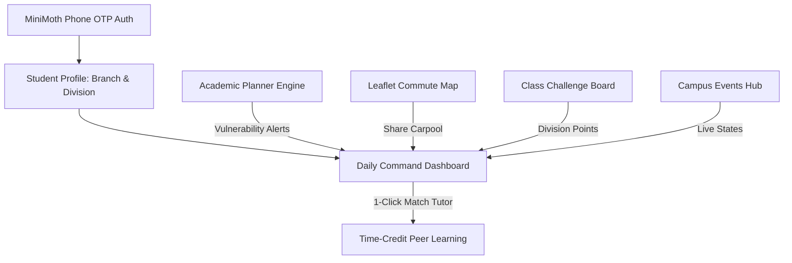

# 🎓 Campus360: One Companion for Every First-Year Need

> Built for **Genesis 2.0 Hackathon** | Problem Statement: **PS-02** | VESIT (Autonomous)

---

## 🚀 Live Demo & Quick Links
- **Platform:** React 19 + Vite + Tailwind CSS v4 + TypeScript + Leaflet OpenStreetMap
- **Authentication:** [MiniMoth](https://minimoth.dev) Phone OTP Gateway & Token Session Engine
- **Demo Mode:** 1-Click Sandbox Bypass for instant evaluation (`+91 98765 43210` / `123456`)

---

## 📌 Problem Background & Our Solution
First-year engineering students face severe fragmentation:
- Academic marks, attendance, and SGPA formulas live in separate PDFs.
- Students calculate SGPA after exams when it is too late to fix anything.
- Carpooling and travel happen haphazardly on unofficial WhatsApp chats.
- Students rarely connect with senior tutors or classmates from other divisions.

**Campus360 connects academics, commute, peer help, and class challenges into one cohesive ecosystem.**

---

## 🧩 Architectural Modules & Key Features



### 1. 📊 Central Dashboard
- **Live Lecture Schedule:** Timeline with "Happening Now", "Up Next", and room numbers.
- **Urgent Deadlines Ticker:** Color-coded priority tags for lab journals and tutorials.
- **Connected Smart Recommendations:** Cross-module alerts (e.g., Mechanics test in 3 days $\rightarrow$ suggested tutors $\rightarrow$ carpool match).
- **Quick Help Hotline:** Instant call triggers for 24/7 VESIT SOS, Exam Cell, and Faculty Mentors.

### 2. 🎓 Academic Planner & Target SGPA Solver (Core Math Engine)
- **Accurate Mathematical Formulas:**
  $$\text{Marks Needed} = \text{Required Total for Grade} - \text{Internal Marks Scored}$$
  $$\text{SGPA} = \frac{\sum (\text{Credits} \times \text{Grade Points})}{\text{Total Credits}}$$
- **Dynamic Grade-Locking Matrix:** If marks needed in the End-Semester exam exceed maximum exam marks, the grade is locked with a padlock badge.
- **Target SGPA Reachability Engine:** Calculates whether a target (e.g. 8.50 or 9.50) is physically **ACHIEVABLE** or **NOT ACHIEVABLE**, providing exact minimum grades needed.
- **Interactive "What-If" Simulator (Bonus USP):** Real-time slider to simulate Unit Test retakes, showing locked grades unlock dynamically.

### 3. 🚗 Commute Sharing & Carpools (Leaflet OpenStreetMap)
- Interactive map centered around VESIT Chembur (19.0463° N, 72.8893° E).
- Routes from Kurla, Ghatkopar, Dadar, Thane, and Navi Mumbai.
- 3-Stage State Machine:
  $$\text{Available} \xrightarrow{\text{Request Seat}} \text{Requested} \xrightarrow{\text{Driver Accepts}} \text{Confirmed}$$
- Verified student badges linked to roll numbers.

### 4. 🏆 Class Challenge Board & Live Leaderboard
- Friendly competition between divisions (D6A, D6B, D7A, D7B, D8, D9).
- Task posting by Class Representatives and Student Council.
- Verification flow with instant point awards and confetti celebration.

### 5. 📍 "Who Do I Contact?" & Campus Guide
- Searchable directory of HODs, Dean of Academics, Exam Cell, and Anti-Ragging Cell.
- OpenStreetMap pins for Main Academic Block, Central Library, Computer Labs, and Canteen.

### 6. 🤝 Peer Learning Time-Credit Economy (Bonus USP)
- Balanced barter economy: **Teach 1 hr = +1 Credit; Learn 1 hr = -1 Credit**.
- Lifecycle: `Matched` $\rightarrow$ `Booked` $\rightarrow$ `Completed`.
- Automated credit transfer upon session completion.

### 7. 🎪 Campus Events Hub with Live States (Bonus USP)
- Automated/interactive event state transitions:
  `Registration Open` $\rightarrow$ `Starting Soon` $\rightarrow$ `Live Now` $\rightarrow$ `Event Ended`.
- 1-click student RSVP and calendar reminders.

---

## 🛠️ Tech Stack
- **Frontend:** React 19, TypeScript, Vite 8, Tailwind CSS v4
- **Icons & Motion:** Lucide React, Canvas Confetti
- **Maps:** Leaflet & OpenStreetMap (CartoDB voyager tiles)
- **Auth:** MiniMoth REST API (`minimoth.dev`) + Offline/Sandbox Simulator
- **Data Persistence:** Browser `localStorage` (Zero external database required for demo)

---

## 🏃 Running Locally

```bash
# 1. Install dependencies
npm install

# 2. Start Vite local development server
npm run dev

# 3. Build for production (Netlify / Vercel)
npm run build
```

---

## 👥 Hackathon Presentation Highlights
1. **No Disconnected Screens:** The academic planner alerts directly feed the dashboard and tutor recommendations.
2. **Mathematical Precision:** Pass criteria, minimum end-sem cutoffs, and locked grades are calculated strictly according to autonomous grading rules.
3. **MiniMoth Integration:** Live session token inspection, token refresh endpoint tests, and 1-click judge sandbox login.
